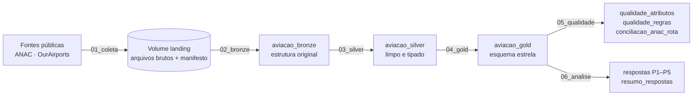
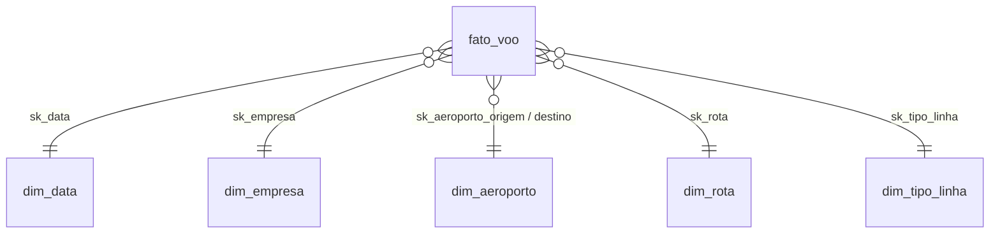
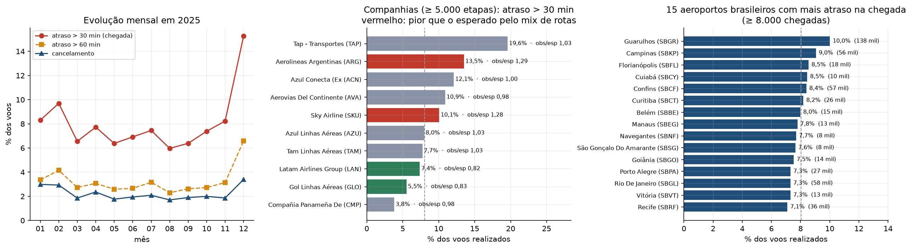
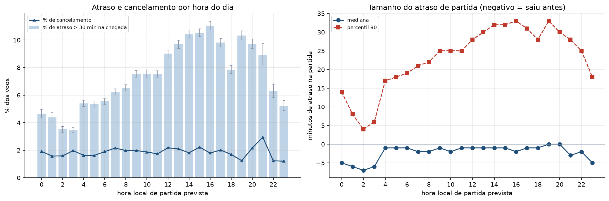
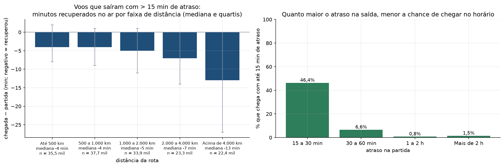
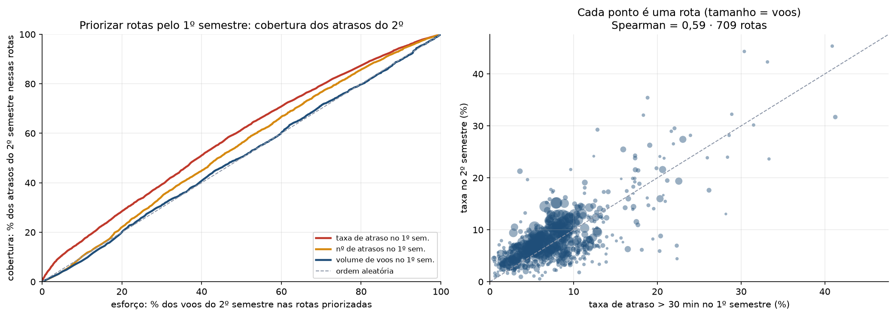
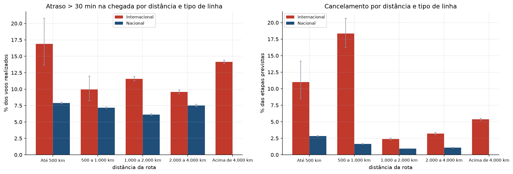

# O que explica o atraso nos voos? Pontualidade da aviação regular brasileira em 2025 (ANAC)

**MVP — Pipeline de dados em nuvem** · Universidade de Brasília · Departamento de Engenharia de Produção
Disciplina: PSP 8 · Professor responsável: André Luiz Marques Serrano · Trabalho individual

**Aluno:** Juliano Teles Abrahao · **Matrícula:** 231013411

Plataforma: **Databricks Free Edition** (Unity Catalog, Delta Lake, computação serverless) ·
Linguagens: Python (PySpark) e SQL · Coleta de referência: **21/10/2026**

---

## Sumário

1. [Resumo executivo](#1-resumo-executivo)
2. [Objetivo](#2-objetivo)
3. [Dados: busca, licenças e ética](#3-dados-busca-licenças-e-ética)
4. [Arquitetura do pipeline](#4-arquitetura-do-pipeline)
5. [Coleta](#5-coleta)
6. [Modelagem e Catálogo de Dados](#6-modelagem-e-catálogo-de-dados)
7. [Carga (ETL)](#7-carga-etl)
8. [Análise de qualidade dos dados](#8-análise-de-qualidade-dos-dados)
9. [Solução do problema — respostas às perguntas](#9-solução-do-problema--respostas-às-perguntas)
10. [Discussão geral](#10-discussão-geral)
11. [Autoavaliação](#11-autoavaliação)
12. [Como reproduzir](#12-como-reproduzir)
13. [Evidências](#13-evidências)
14. [Estrutura do repositório](#14-estrutura-do-repositório)
15. [Referências](#15-referências)

---

## 1. Resumo executivo

Em 2025 a aviação regular brasileira programou **1.005.807 etapas de voo**. Um atraso na chegada de mais de
30 minutos é o indicador oficial de pontualidade da ANAC, mas um número médio esconde o que interessa a quem
planeja operações: **onde, quando e por que os atrasos se concentram**. Este MVP usa o **Voo Regular Ativo
(VRA)** da ANAC, os indicadores oficiais por rota, os cadastros de aeródromos e de empresas e a base
OurAirports (coordenadas) para responder, com dados, cinco perguntas sobre pontualidade.

Antes de qualquer pergunta, a definição de atraso foi **validada contra os números oficiais da ANAC**: em 12.484
rotas-mês com o mesmo número de etapas, o percentual de atraso calculado coincide com o publicado (±0,1 p.p.) em
95,1% dos casos.

| # | Pergunta | Resposta curta |
|---|---|---|
| P1 | Onde e com quem os atrasos se concentram? | **8,0%** dos voos de passageiros chegaram com mais de 30 min de atraso e 2,2% foram cancelados. **Dezembro** foi o pior mês (15,3%, quase o dobro da média). Três companhias (Azul, Latam/TAM e Gol) operam 86% dos voos; **Gol e Latam atrasam menos do que o esperado pelas rotas que voam** (razão observado/esperado de 0,83 e 0,82). Guarulhos tem o maior atraso entre os grandes aeroportos (10,0%). |
| P2 | O atraso depende da hora do dia? | **Sim, e com um padrão claro:** o atraso na chegada sobe de 3,5% (madrugada) e 6,1% (6h–8h) para 9,3% (18h–20h), com pico às 16h (11,0%). A **mediana** da partida quase não muda (entre −2 e 0 min das 4h às 20h); o que cresce ao longo do dia é a **cauda** (percentil 90: de 18 para 33 min). |
| P3 | Quanto do atraso o voo recupera no ar? | **Pouco.** Voos que saem com mais de 15 min de atraso recuperam em mediana 4 a 13 min (mais nas rotas longas), mas só **25%** chegam no horário. Quem sai com 15–30 min de atraso chega no horário em 46% das vezes; com 30–60 min, em 6,6%. |
| P4 | Rotas com atraso persistem? (avaliação prospectiva) | **Persistem, mas pouco:** a correlação entre as taxas do 1º e do 2º semestre é de 0,59. Priorizar 10% dos voos pela taxa do 1º semestre cobre **16,5%** dos atrasos do 2º, contra 9,1% pelo volume (+7,4 p.p.; IC 95%: +5,2 a +9,7). |
| P5 | Distância ou tipo de linha explica o atraso? | **O tipo de linha pesa mais.** Voos internacionais atrasam 12,5% e cancelam 4,3%, contra 7,2% e 1,8% dos nacionais, e perdem em todas as faixas de distância em que há comparação. Entre os nacionais não há relação monótona com a distância. |

**Conclusão:** o atraso na aviação brasileira é um fenômeno de **calendário** (dezembro), de **horário** (a
operação acumula atraso ao longo do dia) e de **tipo de operação** (internacional), muito mais do que de
distância. Para planejar, isso significa tratar o fim da tarde como o período crítico e dar atenção especial às
rotas internacionais de longo curso, onde a persistência entre semestres é maior.

---

## 2. Objetivo

### 2.1 Problema

Em Engenharia de Produção, o transporte aéreo é um **sistema de produção em rede com recursos
compartilhados**: a mesma aeronave e a mesma tripulação executam vários voos por dia, e um atraso no início da
cadeia pode se propagar para os voos seguintes. Medir a pontualidade apenas por uma média anual esconde onde
está o problema. A pergunta de planejamento é **em que momentos e em que partes da rede a pontualidade se
perde**, para decidir onde colocar folga de programação, reforço de solo ou atenção regulatória.

**Hipótese de negócio:** o atraso não é distribuído ao acaso; ele depende do **mês**, da **hora do dia** e do
**tipo de operação**, e essa estrutura é estável o suficiente para orientar o planejamento (hipótese testada
de forma prospectiva na P4).

**Usuário do MVP:** analista de planejamento de operações de uma companhia aérea, de um aeroporto ou da
agência reguladora, que precisa decidir onde concentrar folga e monitoramento.

### 2.2 Perguntas de negócio

As perguntas foram definidas **antes** da escolha das bases e permanecem íntegras, inclusive as respostas que
não confirmaram a expectativa inicial.

| # | Pergunta | Decisão que apoia | Métrica |
|---|---|---|---|
| **P1** | Como o atraso e o cancelamento variam ao longo de 2025 e entre companhias e aeroportos, descontado o efeito das rotas que cada companhia voa? | Onde e quando concentrar atenção; justiça na comparação entre companhias | % de atraso > 30 min; razão observado/esperado pelo mix de rotas |
| **P2** | O atraso depende da hora do dia em que o voo parte, e isso é efeito da hora ou só do tamanho de alguns atrasos? | Horários de maior folga de programação | % de atraso por hora local; mediana e percentil 90 do atraso de partida |
| **P3** | Quando um voo sai atrasado, quanto desse atraso ele recupera no ar, e isso depende da distância? | Margem (*padding*) de tempo de voo | Absorção (atraso na chegada − atraso na partida); % que chega no horário |
| **P4** | As rotas que atrasam mais em um semestre continuam atrasando no seguinte? Priorizá-las cobre mais atrasos do que priorizar as de maior volume, com o mesmo esforço? | Foco de monitoramento e de ações corretivas | Correlação de Spearman; curva de cobertura × esforço; IC 95% por *bootstrap* |
| **P5** | O que pesa mais no atraso: a distância da rota ou o tipo de linha (nacional × internacional)? | Metas de pontualidade por segmento | % de atraso e de cancelamento por faixa de distância e tipo |

### 2.3 As três dimensões do MVP

| Dimensão | Evidência neste trabalho |
|---|---|
| **Viabilidade técnica** | Pipeline completo (coleta → bronze → silver → gold → qualidade → análise) em um Job de 6 tarefas no Databricks Free Edition; tabelas Delta no Unity Catalog; mais de 1 milhão de etapas processadas. |
| **Viabilidade financeira** | Custo de operação **zero** na Free Edition; todas as fontes são gratuitas. O volume (157 MB brutos) é pequeno e a execução completa leva minutos, compatível com uma carga mensal de custo irrelevante mesmo em conta paga. |
| **Desejabilidade** | As cinco perguntas foram respondidas com dados e levam a decisões concretas (seções 9 e 10), inclusive achados contra-intuitivos (a absorção em voo é pequena; a distância sozinha não explica o atraso). |

---

## 3. Dados: busca, licenças e ética

### 3.1 Fontes

| Fonte | Conteúdo | Acesso | Formato | Volume coletado | Licença |
|---|---|---|---|---|---|
| **ANAC — Voo Regular Ativo (VRA)** | Cada etapa de voo regular: empresa, número do voo, origem, destino, horários previstos e reais, situação (realizado/cancelado), tipo de linha | Download direto (pasta de dados abertos da ANAC) | 12 CSV mensais, UTF-8 | **1.005.807 etapas**, 142,5 MB | Dados abertos do governo federal; texto da licença **não confirmado** (ver 3.2) |
| **ANAC — Percentuais de atrasos e cancelamentos (Anexo III)** | Indicador **oficial** por rota e mês (etapas previstas, % de cancelamento, % de atraso > 30 e > 60 min) | Download direto | 12 CSV mensais | 13.635 rotas-mês | idem |
| **ANAC — Aeródromos públicos** | Cadastro de aeródromos, com coordenadas e UF | Download direto | CSV, ISO-8859-1 | 496 aeródromos | idem |
| **ANAC — Empresas aéreas** (nacionais e estrangeiras) | Razão social e código ICAO | Download direto | 2 CSV | 729 + 151 registros | idem |
| **OurAirports** | Aeroportos do mundo, com coordenadas (para aeroportos no exterior e aeródromos privados) | Download direto | CSV | 86.258 registros | Domínio público |

**Data da coleta:** 21/10/2026, 12:41–12:42 (horário local) · **Total:** 28 arquivos, 157,3 MB · **Tempo:** 61 s.
Os arquivos do VRA constam como *atualizados em 07/10/2026*; os do Anexo III, em datas entre 31/07/2025 e
27/05/2026 (ver seção 8, "Atualidade").

> Essa coleta foi feita localmente, para testar o pipeline. Dentro do Databricks a coleta é executada de novo
> pelo notebook `01_coleta` (seção 5).

**Por que 2025 inteiro e só o VRA regular:** o ano completo preserva a sazonalidade (P1), tem volume
suficiente para dividir em dois semestres (P4) e a ANAC já publicou o indicador oficial correspondente, o que
permite **conferir a definição de atraso** (seção 8.2).

### 3.2 Ética, licenciamento e proteção de dados

* **Licenças:** as fontes são dados abertos públicos. O texto da licença específica de cada conjunto da ANAC
  **não pôde ser confirmado** de forma automatizada (a ficha do conjunto no portal exige JavaScript e a página
  da ANAC é protegida por captcha, que não foi contornado). Por isso, **os dados brutos não são
  redistribuídos** neste repositório: ele publica só o código de coleta e resultados agregados. O registro
  completo está no arquivo [`LICENSE`](LICENSE).
* **LGPD (Lei nº 13.709/2018):** o VRA descreve **voos**, não pessoas. O cadastro de empresas aéreas traz
  **endereço, CEP, telefone e e-mail** das empresas; esses quatro campos **não são carregados** em nenhuma
  tabela (regra R12, aplicada já na camada bronze). Nenhum dado de passageiro ou de tripulante é usado.
* **Dados corporativos:** não foram usados.
* **Coleta respeitosa:** o robô identifica-se por *User-Agent*, usa novas tentativas com espera crescente e
  baixa cada arquivo uma única vez por execução.

---

## 4. Arquitetura do pipeline



* **Plataforma:** Databricks Free Edition, catálogo `workspace` do Unity Catalog, três schemas
  (`aviacao_bronze`, `aviacao_silver`, `aviacao_gold`) e um Volume (`aviacao_bronze.landing`) para os arquivos
  brutos. Todas as tabelas são **Delta**.
* **Orquestração:** Job do Databricks com seis tarefas encadeadas, uma por notebook, em computação
  serverless (definição também disponível como *Asset Bundle* em [`databricks.yml`](databricks.yml)).
* **Um código, dois ambientes:** o módulo [`scripts/ambiente.py`](scripts/ambiente.py) faz os mesmos
  notebooks rodarem no Databricks e em Spark 4.0 local. O pipeline foi **testado localmente de ponta a ponta
  antes da execução na nuvem** ([log](evidencias/execucao_local/log_pipeline.txt)).

---

## 5. Coleta

Notebook [`01_coleta`](notebooks/01_coleta.py) · robô em [`scripts/coleta.py`](scripts/coleta.py)

* Baixa as fontes e grava os arquivos **byte a byte como publicados** no Volume `landing`, em subpastas por
  fonte (`vra`, `percentuais`, `aerodromos`, `empresas`, `ourairports`).
* **Descoberta por listagem de diretório:** os nomes dos arquivos da ANAC não seguem um padrão (variam de mês
  para mês), então o robô lista a pasta de cada mês e escolhe o CSV, em vez de montar URLs.
* Registra um **manifesto** (`_manifesto_coleta.json`, também carregado como tabela
  `aviacao_bronze.manifesto_coleta`) com URL, data e hora UTC, tamanho, **hash SHA-256**, codificação de texto,
  número de registros e a data "Atualizado em" que a ANAC grava na primeira linha de cada arquivo. É o ponto de
  partida da linhagem e permite provar que os dados analisados são os coletados.
* Codificação tratada arquivo a arquivo (o cadastro de aeródromos é ISO-8859-1; os demais, UTF-8 com BOM).
* Se a computação serverless não tiver saída para a internet, o mesmo script roda localmente e a pasta é
  enviada ao Volume pela interface — o restante do pipeline não muda.

---

## 6. Modelagem e Catálogo de Dados

Detalhes completos: [**Modelo de dados**](catalogo/modelo_de_dados.md) ·
[**Catálogo de Dados**](catalogo/catalogo_de_dados.md)

O modelo combina as duas abordagens: as camadas bronze e silver são **flat por conceito** (como num Data
Lake) e a camada gold é um **esquema estrela** (como num Data Warehouse).



| Tabela | Grão | Linhas | Conteúdo |
|---|---|---|---|
| `fato_voo` | 1 etapa de voo | 1.005.746 | Horários previstos e reais, situação, atrasos (partida e chegada), absorção, indicadores (atrasou > 15/30/60 min), hora local de partida e flags de universo |
| `dim_data` | 1 dia | 368 | Calendário (dia, mês, semestre, dia da semana) |
| `dim_empresa` | 1 companhia | 111 | Código ICAO e razão social (membros "sem cadastro" quando a ANAC não tem o código) |
| `dim_aeroporto` | 1 aeroporto | 419 | ICAO, município, UF, país, coordenadas e fuso; **papel duplo** na fato (origem e destino) |
| `dim_rota` | par origem → destino | 3.192 | **Distância em km** (Haversine), faixa de distância, rota circular |
| `dim_tipo_linha` | 1 código | 6 | N, I, C, G, NA e "não informado" |

`dim_aeroporto` é uma dimensão com **papel duplo** (*role-playing*): a fato tem duas chaves para ela. O
esquema é estrela e não *snowflake* porque as dimensões são pequenas e o ganho de simplicidade nas consultas
compensa a repetição.

O **Catálogo de Dados** descreve cada atributo das camadas silver e gold com tipo, descrição, domínio
declarado, **domínio observado** (mínimo–máximo ou categorias encontradas), percentual de nulos, significado do
nulo e **linhagem** (campo de origem + regra aplicada). Ele é
gerado por [`scripts/gerar_catalogo.py`](scripts/gerar_catalogo.py) a partir das tabelas carregadas, para nunca
ficar desatualizado em relação aos dados.

---

## 7. Carga (ETL)

Notebooks [`02_bronze`](notebooks/02_bronze.py), [`03_silver`](notebooks/03_silver.py) e
[`04_gold`](notebooks/04_gold.py). Carga **completa e idempotente**: cada execução sobrescreve as tabelas (o
volume é pequeno, e isso elimina problemas de carga incremental num MVP).

**Contagens por camada:**

| Camada | Tabela | Linhas |
|---|---|---|
| Bronze | `vra_voos` | 1.005.807 |
| Bronze | `anac_percentuais_rota` · `anac_aerodromos` · `anac_empresas` · `ourairports` | 13.635 · 496 · 880 · 86.258 |
| Silver | `voo` | 1.005.746 (61 duplicatas removidas) |
| Silver | `aeroporto` · `empresa` · `percentuais_oficiais` | 44.332 · 169 · 13.635 |
| Gold | `fato_voo` + 5 dimensões | 1.005.746 + 368 / 111 / 419 / 3.192 / 6 |

### 7.1 Regras de negócio aplicadas na transformação

| # | Regra | Camada |
|---|---|---|
| R1 | Textos sem espaços nas pontas; códigos de empresa, aeroporto e tipo de linha em maiúsculas | silver |
| R2 | Horários em texto → `TIMESTAMP` em **UTC** (premissa verificada na seção 8.3). A fração de segundo `.100000000`, presente em 6,6% dos horários previstos, é descartada | silver |
| R3 | `cancelado` / `realizado` a partir da situação do voo | silver |
| R4 | **Atraso** = horário real − previsto, em minutos, só para voos realizados com horário previsto. O atraso de **chegada** é a base dos indicadores oficiais da ANAC | silver |
| R5 | `atraso_extremo`: \|atraso\| > 24 h em partida ou chegada (355 voos, 281 com atraso e 74 com antecipação; um deles com 31 dias de atraso). Marcados, **não apagados**; só saem das medidas de magnitude | silver |
| R6 | `tempo_invalido`: chegada não posterior à partida (real ou prevista) — 2 voos | silver |
| R7 | `voo_extra`: número de voo com prefixo `Z` (**inferência**: 84% desses não têm horário previsto) · `rota_circular`: origem = destino · `voo_passageiros`: tipo de linha `N`, `I` ou `NA` (ver 8.4) | silver |
| R8 | **Duplicatas**: mesma empresa, voo, rota, horário de referência e tipo de linha. Fica o registro cujo horário real é mais coerente com o previsto (menor \|atraso de partida\|) | silver |
| R9 | `ano_mes` é o mês do **arquivo** de origem (a atribuição oficial da ANAC), não o mês do horário em UTC | silver |
| R10 | Aeroportos: coordenadas da ANAC têm precedência; OurAirports completa os demais. A UF do OurAirports só vale no formato `BR-XX` (a região desconhecida `BR-U-A`, de 9 pistas privadas, fica sem UF) | silver |
| R11 | **Fuso horário** dos aeroportos brasileiros por UF, com 3 exceções (Fernando de Noronha, Tabatinga e Eirunepé). Aeroportos no exterior ficam sem fuso | silver |
| R12 | Empresas: razão social por código ICAO; vale a ativa e mais recente. **Endereço, CEP, telefone e e-mail não são carregados** (LGPD) | bronze/silver |
| R13 | Percentuais oficiais: vírgula decimal → ponto; mês extraído do nome do arquivo | silver |
| R14 | Toda chave estrangeira da fato aponta para uma linha real da dimensão; códigos sem cadastro ganham uma linha própria ("sem cadastro"); nenhuma chave fica nula | gold |
| R15 | `dim_rota`: distância em km pela fórmula de Haversine sobre as coordenadas; sem coordenada, fica nula | gold |
| R16 | `hora_partida_local`: horário previsto de partida convertido de UTC para o fuso do aeroporto de origem (só aeroportos brasileiros) | gold |
| R17 | `no_universo_oficial` = voo de passageiros com horário previsto — o universo dos indicadores da ANAC | gold |
| R18 | `mede_magnitude` = universo oficial, realizado, sem atraso extremo, sem tempo inválido e sem rota circular — usado quando se mede **quanto** atrasou (medianas, absorção) | gold |

**Escolha de projeto:** nada é apagado por ser "estranho". Voos extremos, circulares e sem horário previsto
**permanecem na fato**, marcados por colunas booleanas, e cada análise declara qual universo usa. Assim a
escolha é explícita e reversível.

### 7.2 Verificações automáticas da carga

* **Conferência de volume:** as contagens da bronze batem exatamente com o manifesto da coleta (VRA 1.005.807;
  Anexo III 13.635; aeródromos 496; empresas 880; OurAirports 86.258), e o cabeçalho de cada CSV do VRA é conferido.
* **Integridade referencial:** zero chaves órfãs nas seis chaves estrangeiras da fato.
* **Grão:** uma linha por etapa de voo, sem repetições. Qualquer violação interrompe o Job (`assert`).

---

## 8. Análise de qualidade dos dados

Notebook [`05_qualidade`](notebooks/05_qualidade.py) · tabelas `aviacao_gold.qualidade_atributos`,
`aviacao_gold.qualidade_regras` (20 verificações) e `aviacao_gold.conciliacao_anac_rota`.

### 8.1 Por atributo

Os 80 atributos das tabelas silver e da fato foram perfilados (percentual de nulos, valores distintos, mínimo,
máximo) e testados contra o domínio declarado no catálogo. Resultado:

* **Nulos esperados:** horários reais nulos em 2,75% (voos cancelados); horários previstos nulos em 2,80%
  (voos extras, sem horário programado); atrasos nulos em 5,56%; hora local nula em 11,9% (origem no exterior).
* **Violações de domínio, por atributo:**
  * `atraso_partida_min` (303) e `atraso_chegada_min` (338): fora de ±24 h. São os voos já sinalizados em
    `atraso_extremo` (R5); o mínimo é −2.890 min (48 h de antecipação) e o máximo, 44.635 min (31 dias).
  * `uf` de aeroportos: 9 valores `U-` vindos do código de região `BR-U-A` do OurAirports (pistas agrícolas
    privadas, sem voo regular). **Detectado pelo perfil e corrigido** na regra R10 (passam a nulos).

### 8.2 Conciliação com os indicadores oficiais da ANAC

A ANAC publica, por rota e mês, o percentual oficial de atraso e de cancelamento. O pipeline recalcula esses
indicadores a partir do VRA e os compara com os oficiais. É a **prova de que a definição de atraso usada nas
análises é a da ANAC** (atraso na chegada > 30 min, dividido pelos voos realizados, voos de passageiros com
horário previsto).

| Verificação | Resultado |
|---|---|
| Rotas-mês no VRA × no oficial × em ambos | 14.759 × 13.635 × 13.635 (nenhuma rota oficial ficou de fora) |
| Rotas-mês só no VRA | 1.124 (3.381 etapas) |
| Etapas previstas: VRA × oficial | 944.222 × 938.280 (**+0,63%**) |
| Rotas-mês com o mesmo nº de etapas | 91,6% |
| % de atraso > 30 min: diferença média | 0,24 p.p. (0,12 p.p. ponderada por voos); correlação **0,98** |
| Rotas-mês coincidentes em ±0,1 p.p. | 90,6% (atraso) · 94,3% (cancelamento) |
| **Só nas rotas-mês com o mesmo nº de etapas** (12.484) | **95,1%** (atraso) e **97,0%** (cancelamento) coincidem em ±0,1 p.p. |

As diferenças restantes concentram-se nas rotas-mês em que o número de etapas já difere, o que é esperado: o
VRA foi baixado atualizado em outubro de 2026, enquanto cada Anexo III foi publicado entre 2025 e 2026, e a ANAC
revisa o VRA depois da publicação.

### 8.3 Verificações entre atributos e entre fontes

| Dimensão | Verificação | Ocorrências | Impacto | Tratamento |
|---|---|---|---|---|
| Unicidade | Etapas repetidas pela chave natural | 61 (0,006%) | Dupla contagem | Fica a de horário real mais coerente (R8) |
| Conformidade | Horários previstos com fração de segundo `.100000000` | 66.695 (6,6%) | Nenhum (0,1 s) | Descartada (R2); sem isso, a leitura direta os marca como inválidos |
| Conformidade | Código de tipo de linha literal `NA` | 463 (0,046%) | P1 (cancelamentos de abr–jul) | Mantido como código próprio; ver 8.4 |
| Completude | Código de justificativa sem informação (texto `N/A`) | 1.005.807 (100%) | Impede analisar causas | Coluna não usada; limitação declarada |
| Completude | Voos realizados sem horário previsto | 28.196 (2,9%) | Atraso não mensurável | Fora do universo oficial (R17) |
| Completude | Voos com prefixo `Z` sem horário previsto | 24.795 de 29.547 (83,9%) | Sustenta a inferência de voo extra | `voo_extra` (R7) |
| Consistência | Cancelado com horário real · realizado sem horário real | 0 · 0 | — | — |
| Consistência | Chegada não posterior à partida | 2 | P3 | `tempo_invalido` (R6) |
| Consistência | Origem igual ao destino | 4.043 (0,40%) | Distância zero | `rota_circular`; fora das medidas de magnitude |
| Consistência | Mês do arquivo ≠ mês do horário previsto em UTC | 240 (0,025%) | P1 | Vale o mês do arquivo (R9) |
| Acurácia | \|Atraso\| > 24 h (partida ou chegada) | 355 (0,037%) | Distorce médias | `atraso_extremo` (R5) |
| Acurácia | Antecipação de partida > 2 h | 585 (0,062%) | Pouco plausível | Mantidos; fora das medidas de magnitude se > 24 h |
| Acurácia | Velocidade implícita fora de 150–1.100 km/h (distância ≥ 100 km) | 693 (0,075%) | P3, P5 | Concentra-se em rotas muito curtas (ex.: SBCF–SNDV, 112 km); mantidos |
| Completude | Aeroportos do VRA sem coordenadas | 4 de 419 | Distância indisponível | Distância nula nessas rotas |
| Completude | Voos de empresas sem razão social no cadastro | 2.904 (0,29%) | Nome da companhia (P1) | Membro "sem cadastro" (R14) |
| Conformidade | Coordenada ANAC × OurAirports difere > 5 km | 1 de 495 | Distância | Vale a da ANAC (R10) |
| Consistência | Rotas-mês com nº de etapas diferente do oficial | 1.151 (8,4%) | Pequenas diferenças nos percentuais | Ver 8.2 |
| Consistência | Rotas-mês com atraso diferindo > 0,1 p.p. do oficial | 1.059 (7,8%) | Validação da definição | Ver 8.2 |

**Atualidade.** O VRA foi atualizado pela ANAC em 07/10/2026; o cadastro de aeródromos, em 15/10/2026; e o
Anexo III de cada mês foi publicado em datas que vão de 31/07/2025 a 27/05/2026. Os arquivos de percentuais
dos meses mais antigos podem, portanto, estar defasados em relação ao VRA revisado — explicação para as 8,4% de
rotas-mês com número de etapas diferente.

**Premissa de fuso (UTC).** O dicionário do VRA não informa o fuso dos horários. Se fossem locais, a duração
prevista de uma rota entre fusos diferentes mudaria conforme o sentido. Em UTC, ida e volta têm a mesma
duração. O notebook mede isso (seção 3b) e a premissa de UTC se sustenta: a mediana da duração prevista é
**240 min de Guarulhos a Manaus e 235 min na volta** (fusos com 1 h de diferença); **135 e 135 min** entre
Guarulhos e Cuiabá; **585 e 585 min** entre Guarulhos e Nova York. A maior diferença entre sentidos é de 10 min
(em hora local seria de 60 a 120 min).

### 8.4 Achados que merecem destaque

* **O texto `NA` desaparece em quem lê com o padrão do pandas.** Em 463 voos (todos **cancelados**, de abril a
  julho) o código de tipo de linha é a string literal `NA`. O pandas e muitas ferramentas leem `NA` como
  valor ausente; a primeira versão do pipeline "perdia" essas linhas na dimensão e a integridade referencial
  acusou 463 chaves órfãs. A leitura passou a tratar `NA` como texto. **Decisão (inferência):** tratar `NA`
  como voo de passageiros, porque a inclusão aproxima o VRA do indicador oficial de cancelamento nesses meses.
  Não há dicionário público que confirme o significado de `NA`; também não há dicionário para os códigos `C` e
  `G`, que ficam fora das análises de passageiros.
* **A coluna de justificativa vem "preenchida" com `N/A` em todas as linhas.** Um teste de "não nulo" diria
  100% de preenchimento; o conteúdo é vazio de informação. Por isso as **causas** de atraso e de cancelamento
  não podem ser analisadas com este conjunto.
* **O VRA não identifica a aeronave.** Sem a matrícula da aeronave, a propagação do atraso entre voos
  consecutivos não pode ser medida diretamente; a P2 e a P3 a tratam de forma indireta.

---

## 9. Solução do problema — respostas às perguntas

Notebook [`06_analise`](notebooks/06_analise.py) · consultas SQL equivalentes em
[`sql/consultas_analise.sql`](sql/consultas_analise.sql) · indicadores em `aviacao_gold.resumo_respostas`.

**Universo de análise:** 947.603 etapas de voos de passageiros com horário previsto (`no_universo_oficial`), das
quais 8,0% chegaram com mais de 30 minutos de atraso (divididos pelos voos realizados) e 2,2% foram canceladas.
Intervalos de confiança de proporções: Wilson, 95%.

### 9.1 P1 — Evolução mensal, companhias e aeroportos



| Mês | Etapas | Atraso > 30 min | Atraso > 60 min | Cancelamento |
|---|---|---|---|---|
| jan | 84.448 | 8,3% | 3,4% | 3,0% |
| fev | 74.245 | 9,7% | 4,2% | 2,9% |
| mar | 77.519 | 6,6% | 2,7% | 1,9% |
| abr | 76.086 | 7,7% | 3,1% | 2,4% |
| mai | 78.042 | 6,4% | 2,6% | 1,8% |
| jun | 76.537 | 6,9% | 2,7% | 1,9% |
| jul | 82.906 | 7,5% | 3,2% | 2,1% |
| ago | 80.260 | 6,0% | 2,3% | 1,7% |
| set | 78.017 | 6,4% | 2,6% | 1,9% |
| out | 80.319 | 7,4% | 2,7% | 2,0% |
| nov | 76.070 | 8,2% | 3,1% | 1,9% |
| **dez** | 83.154 | **15,3%** | **6,6%** | **3,4%** |

**Companhias.** Para comparar companhias de forma justa, calcula-se a **taxa esperada** de cada uma: a taxa
média de todas as companhias nas mesmas rotas, ponderada pelos voos da companhia. A razão
**observado/esperado** acima de 1 indica atraso maior do que o que as rotas "explicam".

| Companhia | Etapas | % dos voos | Atraso > 30 min | Cancelamento | Observado/esperado |
|---|---|---|---|---|---|
| TAP | 10.091 | 1,1% | 19,6% | 1,4% | 1,03 |
| Aerolíneas Argentinas | 8.373 | 0,9% | 13,5% | 4,4% | **1,29** |
| Azul Conecta | 16.178 | 1,7% | 12,1% | 13,8% | 1,00 |
| Aerovías del Continente | 5.153 | 0,5% | 10,9% | 2,5% | 0,98 |
| Sky Airline | 6.248 | 0,7% | 10,1% | 13,6% | **1,28** |
| Azul | 290.930 | 30,7% | 8,0% | 1,5% | 1,03 |
| Latam (TAM) | 286.680 | 30,3% | 7,7% | 1,6% | 1,03 |
| Latam Airlines Group | 11.021 | 1,2% | 7,4% | 0,7% | **0,82** |
| Gol | 236.619 | 25,0% | 5,5% | 1,1% | **0,83** |
| Copa | 8.758 | 0,9% | 3,8% | 0,4% | 0,98 |

**Aeroportos** (os 22 brasileiros com ao menos 8.000 chegadas): maior atraso em **Guarulhos** (10,0%, 138 mil
chegadas), **Campinas** (9,1%), **Florianópolis** (8,6%), **Cuiabá** (8,5%) e **Confins** (8,4%); menor em
**Santos Dumont** (5,4%), **Brasília** (5,7%) e **Maceió** (5,5%).

**Resposta.** O atraso médio de 8,0% esconde uma sazonalidade forte: **dezembro tem quase o dobro da média (15,3%)**,
com atraso longo (> 60 min) e cancelamentos também no pico; fevereiro (9,7%) é o segundo pior e agosto (6,0%)
o melhor. Três grupos (Azul, Latam/TAM e Gol) operam 86% dos voos. Entre as companhias grandes, **Gol (5,5%) e
Latam Airlines Group (7,4%) atrasam menos do que o esperado** pelas rotas que voam (0,83 e 0,82), enquanto
Azul e Latam/TAM ficam no esperado (1,03). A TAP tem a maior taxa bruta (19,6%), mas a razão 1,03 mostra que isso
vem das rotas (transatlânticas longas), não de desempenho pior na mesma rota. Já **Aerolíneas Argentinas (1,29) e
Sky (1,28)** atrasam acima do que as rotas explicam. Em cancelamento destacam-se a Azul Conecta (13,8%) e a Sky
(13,6%), mas com poucos voos (menos de 2% do total).

**Discussão.** A comparação bruta entre companhias engana; a padronização pelo mix de rotas é o que dá
sentido ao ranking. O pico de dezembro é consistente com a demanda de fim de ano (hipótese; o VRA não traz
causas, ver 8.4). O maior atraso em Guarulhos pode refletir seu porte e a presença de voos
internacionais, que atrasam mais (P5); essa explicação não foi testada. **Decisão:** a folga de programação e o reforço de solo devem ser sazonais
(dezembro e, em menor grau, fevereiro), e a cobrança de pontualidade das companhias deve usar o indicador
padronizado pelo mix de rotas, e não a taxa bruta.

### 9.2 P2 — Atraso por hora do dia



| Faixa de hora local de partida | Atraso > 30 min na chegada | Percentil 90 do atraso de partida |
|---|---|---|
| madrugada (2h–3h) | 3,5% | 4–6 min |
| 6h–8h | 6,1% | 19–22 min |
| 12h–16h | 9,0% a 11,0% (pico às 16h) | 28–33 min |
| 18h–20h | 9,3% | 28–33 min |
| 22h–23h | 5,2% a 6,3% | 18–25 min |

**Resposta.** O atraso **cresce ao longo do dia**: voos das 6h às 8h chegam com mais de 30 min de atraso em
6,1% dos casos; os das 18h às 20h, em 9,3% (**1,5×**). A correlação de Spearman entre a hora (5h–22h) e o
percentual de atraso é de **0,57** (p = 0,013). O cancelamento, ao contrário, é praticamente plano (cerca de 2%
em todas as horas, com um pico de 3,0% às 21h, onde há poucos voos). Um detalhe importante: a **mediana** do
atraso de partida fica entre −2 e 0 min das 4h às 20h (a maioria dos voos sai no horário), mas o **percentil 90**
sobe de 18 min (5h) para 33 min (16h–19h). **O efeito da hora está na cauda**: poucos voos acumulam atrasos
grandes ao longo do dia.

**Discussão.** Esse padrão (mediana estável, cauda crescente) é o que se espera de uma operação em que atrasos
**se propagam** entre voos que compartilham aeronave e tripulação: o primeiro voo da manhã parte com a rede
"limpa" e cada atraso se soma ao seguinte. O VRA não traz a matrícula da aeronave, portanto **a propagação não
foi medida diretamente**: o resultado é compatível com ela, não a prova. A hora também se mistura com aeroporto
e companhia (os horários de pico concentram os hubs). O vale às 21h locais (5.360 voos, contra 29.816 às 20h) é
real: a programação doméstica brasileira praticamente termina por volta de 20h59, e não há acúmulo de horários
`00:00` que sugira erro de preenchimento. **Decisão:** concentrar a folga de programação (tempo de solo e
reservas de tripulação) na **tarde e início da noite**; um voo programado às 16h tem o dobro do risco de um das 6h.

### 9.3 P3 — Quanto do atraso se recupera no ar



Voos que saíram com **mais de 15 min de atraso** (152.703 voos). *Absorção* = atraso na chegada − atraso na
partida; negativa significa que o voo recuperou tempo.

| Distância da rota | Voos | Mediana do atraso na partida | Mediana da absorção | % que chega no horário (≤ 15 min) | % que recupera algo |
|---|---|---|---|---|---|
| Até 500 km | 35.536 | 32 min | −4 min | 17,5% | 66,3% |
| 500 a 1.000 km | 37.656 | 30 min | −4 min | 20,5% | 68,3% |
| 1.000 a 2.000 km | 33.850 | 30 min | −5 min | 25,0% | 70,6% |
| 2.000 a 4.000 km | 23.272 | 29 min | −7 min | 30,6% | 73,4% |
| Acima de 4.000 km | 22.389 | 32 min | **−13 min** | **40,4%** | 73,6% |

| Atraso na partida | Voos | Mediana da absorção | % que chega no horário |
|---|---|---|---|
| 15 a 30 min | 75.874 | −5 min | **46,4%** |
| 30 a 60 min | 45.832 | −5 min | 6,6% |
| 1 a 2 h | 20.138 | −5 min | 0,8% |
| Mais de 2 h | 10.859 | −6 min | 1,5% |

**Resposta.** A recuperação em voo **existe, mas é pequena**: a mediana é de 4 a 5 min nas rotas até 2.000 km
e chega a 13 min acima de 4.000 km, onde há mais tempo para ganhar. Cerca de 70% dos voos atrasados recuperam
algum tempo, mas só **25%** chegam no horário. O que decide é o **tamanho do atraso na saída**: quem sai com
15–30 min de atraso chega no horário em 46% dos casos; com 30–60 min, em 6,6%; acima de 1 h, praticamente
nenhum. A recuperação não depende do tamanho do atraso (mediana de −5 min em todas as faixas).

**Discussão.** Os minutos recuperados são, provavelmente, a folga já embutida no tempo de voo programado
(*padding*) e a diferença entre o tempo programado e o realizado; o VRA não permite separar a folga do ganho de
velocidade. A consequência prática é que **a recuperação em voo não "limpa" um atraso na saída**: o atraso de
partida se transforma, quase um para um, em atraso na chegada, e portanto em possível atraso do voo seguinte
da mesma aeronave (P2). O valor de 1,5% para atrasos acima de 2 h (maior que o de 0,8% da faixa de 1 a 2 h) é
pequeno e provavelmente reflete voos reprogramados; não foi investigado. **Decisão:** a ação eficaz é
**evitar o atraso na partida** (solo, embarque, tripulação), e não contar com a recuperação em voo.

### 9.4 P4 — Persistência das rotas (avaliação prospectiva)



**Desenho.** Para evitar o erro de "prever o passado", usa-se uma avaliação **prospectiva**: as rotas são
ordenadas apenas com dados do **1º semestre** e avalia-se quantos atrasos do **2º semestre** elas cobrem.
População: rotas não circulares com ao menos 100 voos realizados **em cada** semestre — **709 rotas**, com
443.350 voos realizados e 37.002 atrasados (> 30 min) no 2º semestre (taxa de 8,3%). O "esforço" é a
fração dos voos do 2º semestre nas rotas priorizadas; a "cobertura", a fração dos atrasos do 2º semestre nelas.
Em cada alvo de esforço vale a primeira rota em que o esforço o alcança (empates pela chave da rota).

| Critério de priorização (1º semestre) | Cobertura com 5% dos voos | com 10% | com 20% |
|---|---|---|---|
| **taxa de atraso** | **10,7%** | **16,5%** | **28,5%** |
| nº de atrasos | 4,1% | 10,2% | 22,4% |
| volume de voos (referência) | 4,2% | 9,1% | 20,5% |

**Resposta.** As rotas **persistem**: a correlação de Spearman entre as taxas dos dois semestres é de **0,59**.
As 70 rotas (10%) de maior taxa no 1º semestre tiveram **18,9%** de atraso no 2º; as demais, 7,9% (**2,4×**).
Com 10% do esforço, priorizar pela taxa cobre **16,5%** dos atrasos do 2º semestre, contra 9,1% pelo volume:
**+7,4 p.p.** (IC 95% por *bootstrap* sobre as rotas, 500 reamostragens: **+5,2 a +9,7 p.p.**, não inclui o zero).
O critério de volume ficou praticamente sobre a diagonal (equivale a escolher rotas ao acaso).

**Discussão.** A hipótese de persistência foi **confirmada, com ressalva de magnitude**: priorizar pelo
histórico é melhor do que priorizar pelo tamanho da rota, mas o ganho é moderado (com 10% do esforço, 16,5% dos
atrasos). Isso quer dizer que a maioria dos atrasos está **espalhada** em muitas rotas, e não concentrada em
poucas: as 70 rotas de topo respondem por 4,3% dos voos e por **9,6%** dos atrasos do 2º semestre. **54 dessas 70
rotas são internacionais**, embora as internacionais sejam só 164 das 709 da população (23%); por exemplo,
Lisboa–Campinas (41% → 32%), Newark–Guarulhos (41% → 45%) e Chicago–Guarulhos (33% → 42%). Entre as nacionais do
topo estão rotas como Congonhas–Goianá/MG (SBSP–SBZM, 22%) e Passo Fundo–Guarulhos (SBPF–SBGR, 22%). **Decisão:** um painel de monitoramento por
rota, atualizado a cada semestre, é útil para o **topo da lista**, onde predominam as rotas internacionais, mas
não substitui medidas gerais de horário e de sazonalidade (P1 e P2) para a maior parte dos atrasos.

### 9.5 P5 — Distância × tipo de linha



| Faixa de distância | Tipo | Etapas | Atraso > 30 min | Cancelamento |
|---|---|---|---|---|
| Até 500 km | Nacional | 246.328 | 7,9% | 2,9% |
| Até 500 km | Internacional | 472 | 16,9% | 11,0% |
| 500 a 1.000 km | Nacional | 260.192 | 7,2% | 1,7% |
| 500 a 1.000 km | Internacional | 1.183 | 9,9% | 18,3% |
| 1.000 a 2.000 km | Nacional | 188.663 | 6,1% | 0,9% |
| 1.000 a 2.000 km | Internacional | 40.102 | 11,6% | 2,4% |
| 2.000 a 4.000 km | Nacional | 94.506 | 7,5% | 1,1% |
| 2.000 a 4.000 km | Internacional | 33.999 | 9,6% | 3,2% |
| Acima de 4.000 km | Internacional | 81.694 | 14,2% | 5,4% |
| **Todas** | **Nacional** | 789.689 | **7,2%** | **1,8%** |
| **Todas** | **Internacional** | 157.450 | **12,5%** | **4,3%** |

**Resposta.** O **tipo de linha pesa mais do que a distância**. Os voos internacionais atrasam 12,5% e
cancelam 4,3%, contra 7,2% e 1,8% dos nacionais, e **perdem em todas as faixas de distância em que há
comparação** (com diferença grande onde há volume: 11,6% × 6,1% entre 1.000 e 2.000 km). Entre os nacionais, a
relação com a distância **não é monótona**: o atraso é menor nas rotas médias (6,1% entre 1.000 e 2.000 km) e
maior nas curtas (7,9%) e nas longas (7,5%). No nível da rota (746 rotas com ao menos 200 voos), a
correlação de Spearman da distância com a taxa de atraso é **fraca (0,14)** e, com a taxa de cancelamento,
levemente negativa (−0,26): rotas mais longas cancelam menos.

**Discussão.** Duas ressalvas. (i) Acima de 4.000 km só há voos internacionais, então nessa faixa distância e
tipo se confundem e **não é possível separá-los**. (ii) As faixas internacionais curtas (até 1.000 km) têm
poucas etapas (472 e 1.183) e **intervalos de confiança largos**; os 18,3% de cancelamento da faixa de 500 a
1.000 km não devem ser generalizados. O efeito do tipo de linha pode refletir a dependência de condições
externas (aeroportos estrangeiros, controle de tráfego, janelas de pouso), que o VRA não captura.
**Decisão:** metas de pontualidade devem ser **diferenciadas** entre operação doméstica e internacional, e
comparar companhias sem controlar o tipo de linha (como na P1) é um erro.

---

## 10. Discussão geral

As cinco respostas descrevem o mesmo fenômeno por ângulos diferentes: **a pontualidade se perde no
calendário (P1), ao longo do dia (P2) e na operação internacional (P5), e depois da saída o voo recupera
pouco (P3)**. As rotas importam, mas menos do que o horário (P4).

A expectativa inicial, de que a distância seria um fator relevante, **não foi confirmada**: no tráfego
doméstico a relação é fraca e não monótona, e o que diferencia os voos é o tipo de linha. A hipótese de
estabilidade da estrutura de atraso foi **confirmada com moderação**: existe persistência por rota, mas a maioria
dos atrasos está pulverizada.

Em termos de decisão, o conjunto aponta para **três alavancas**, em ordem de impacto:

1. **Horário:** folga de programação e reforço de solo na tarde e início da noite, onde a cauda do atraso cresce
   e a recuperação em voo não compensa.
2. **Sazonalidade:** plano específico para dezembro (e fevereiro), com atraso e cancelamento duas vezes acima do
   normal.
3. **Operação internacional:** metas e monitoramento próprios, com atenção às rotas de longo curso de maior
   persistência.

Em termos de Engenharia de Produção, o resultado descreve uma **linha de produção com acúmulo de atraso ao
longo do turno**: o remédio não é "voar mais rápido" (P3), é **proteger o início de cada ciclo** (a partida) e
dimensionar folga onde o sistema acumula perturbação.

---

## 11. Autoavaliação

**Quais perguntas foram respondidas e quais não?**
As cinco foram respondidas com dados. P1, P2, P3 e P5 têm respostas firmes. A **P4 foi respondida com ressalva**:
a persistência existe (correlação 0,59; ganho de +7,4 p.p. com IC que não inclui o zero), mas é moderada e
medida em **um único ano** dividido em dois semestres. Na P2, a **propagação do atraso** entre voos não pôde ser
medida diretamente (falta a matrícula da aeronave): o resultado é compatível com ela, não a prova. Na P3, não
é possível separar a folga programada do ganho de velocidade. A pergunta sobre **causas** (clima, manutenção,
tripulação) **não pôde ser respondida**: a coluna de justificativa vem com `N/A` em todas as linhas.

**Que limitações dos dados condicionaram os resultados?**
* O VRA **não identifica a aeronave** nem informa a **causa** dos atrasos.
* O fuso dos horários **não está no dicionário**: a premissa de UTC foi verificada (seção 8.3), mas é uma inferência.
* O significado dos códigos de tipo de linha `NA`, `C` e `G` **não é público**; `NA` foi tratado como passageiros
  por inferência, e `C` e `G` ficaram fora.
* O prefixo `Z` como "voo extra" também é inferência (84% dos casos sem horário previsto).
* O Anexo III de cada mês foi publicado em datas diferentes; o VRA foi baixado depois de revisado. Isso explica as
  diferenças residuais da conciliação (8,4% das rotas-mês).
* A **licença** específica dos dados da ANAC não pôde ser confirmada; por isso os dados brutos não são
  redistribuídos.
* **Um único ano**: a sazonalidade (P1) é a de 2025; não há como saber quanto dezembro de 2025 é típico.

**Que decisões técnicas eu tomaria de outra forma?**
* **Vários anos** de VRA (2023 a 2025) para separar sazonalidade de eventos pontuais e dar mais folga à avaliação
  prospectiva da P4 (hoje, uma única divisão em semestres).
* Cruzar com **meteorologia** (METAR) para atacar a pergunta de causas, que o VRA não permite.
* Ler **todos** os arquivos com tipos explícitos desde o início: a armadilha do `NA` custou uma rodada de
  depuração e só foi detectada pela verificação de integridade referencial.
* Testar a **saída para a internet do serverless** do Databricks logo no início.

**Que extensões transformariam o MVP em solução de uso contínuo?**
* **Job mensal agendado** com carga **incremental** (`MERGE` no Delta, por mês de arquivo) em vez de sobrescrever tudo.
* **Painel** no Databricks (AI/BI Dashboards) com o indicador padronizado pelo mix de rotas, a curva por hora e o
  ranking de rotas persistentes.
* **Alertas** quando uma rota entrar no topo da lista de persistência ou quando a taxa mensal ultrapassar um limite.
* **Expectativas de qualidade** declarativas (Lakeflow Declarative Pipelines) no lugar das verificações em notebook.
* Dados de **aeronave e tripulação** (quando houver) para medir a propagação em cadeia do atraso.

---

## 12. Como reproduzir

### 12.1 No Databricks (Free Edition)

1. Crie uma conta gratuita em <https://www.databricks.com/learn/free-edition>.
2. **Workspace → Create → Git folder** e informe a URL deste repositório (público; não precisa de
   credenciais para clonar).
3. Abra `notebooks/01_coleta` e execute com a computação **Serverless**. Ele cria os schemas
   `aviacao_bronze`, `aviacao_silver`, `aviacao_gold` e o Volume `landing`, e baixa os dados (cerca de 1 min).
   *Se o download falhar por falta de acesso à internet:* no seu computador, rode
   `python scripts/coleta.py --destino dados/landing` e envie o conteúdo de `dados/landing` para o Volume em
   *Catalog → workspace → aviacao_bronze → landing → Upload to this volume*, mantendo as subpastas. Depois,
   execute o notebook novamente.
4. **Pipeline como Job:** *Jobs & Pipelines → Create → Job*. Crie seis tarefas do tipo *Notebook*
   (`01_coleta` a `06_analise`, na pasta `notebooks` do Git folder), cada uma dependente da anterior, com
   computação *Serverless*, e clique em *Run now*. (Alternativa pela CLI:
   `databricks bundle deploy && databricks bundle run pipeline_mvp_aviacao`.)
5. Consultas: abra `sql/consultas_analise.sql` no *SQL Editor*.

### 12.2 Localmente (usado para testar o pipeline antes da nuvem)

```bash
pip install -r requirements.txt          # requer também um JDK 17 ou 21 (JAVA_HOME)
python scripts/coleta.py --destino dados/landing
python scripts/executar_local.py         # executa os 6 notebooks em Spark local
python scripts/gerar_catalogo.py         # atualiza catalogo/catalogo_de_dados.md
```

Em máquinas com pouca memória, o pipeline exporta a silver para Parquet e pode ser retomado dela com
`python scripts/executar_local.py --restaurar 04 05 06`.

---

## 13. Evidências

* **Gráficos das respostas:** [`evidencias/graficos/`](evidencias/graficos/) (inseridos na seção 9).
* **Execução local completa** (teste antes da nuvem): [`log_coleta.txt`](evidencias/execucao_local/log_coleta.txt)
  e [`log_pipeline.txt`](evidencias/execucao_local/log_pipeline.txt) — coleta de 28 arquivos, carga de todas as
  tabelas, verificações de integridade, conciliação com a ANAC e resultados de P1–P5.
* **Execução na nuvem (Databricks):** capturas de tela em [`evidencias/databricks/`](evidencias/databricks/).

---

## 14. Estrutura do repositório

| Caminho | Conteúdo |
|---|---|
| `README.md` | Este documento |
| `notebooks/` | `01_coleta` … `06_analise` — pipeline completo (formato de notebook do Databricks) |
| `scripts/` | `coleta.py` (robô de coleta), `ambiente.py` (configuração Databricks/local), `executar_local.py`, `gerar_catalogo.py` |
| `sql/` | Consultas das perguntas para o SQL Editor |
| `catalogo/` | [Modelo de dados](catalogo/modelo_de_dados.md) (diagramas) e [Catálogo de Dados](catalogo/catalogo_de_dados.md) |
| `evidencias/` | Gráficos, logs de execução e capturas do Databricks |
| `databricks.yml` | Definição do Job como Asset Bundle (opcional) |
| `LICENSE` | Licença MIT do código e registro das licenças dos dados |

---

## 15. Referências

* ANAC. *Dados abertos — Voo Regular Ativo (VRA)*. <https://sistemas.anac.gov.br/dadosabertos/>
* ANAC. *Percentuais de atrasos e cancelamentos (Anexo III)* e *Lista de aeródromos públicos*; cadastro de
  empresas aéreas nacionais e estrangeiras. <https://sistemas.anac.gov.br/dadosabertos/>
* OurAirports. *Airports*. <https://ourairports.com/data/>
* BRASIL. Decreto nº 8.777, de 11 de maio de 2016 — Política de Dados Abertos do Poder Executivo federal.
* BRASIL. Lei nº 13.709, de 14 de agosto de 2018 — Lei Geral de Proteção de Dados Pessoais (LGPD).
* Wilson, E. B. Probable inference, the law of succession, and statistical inference. *Journal of the American
  Statistical Association*, v. 22, n. 158, 1927.
* Databricks. *Databricks Free Edition*. <https://docs.databricks.com/aws/en/getting-started/free-edition>
