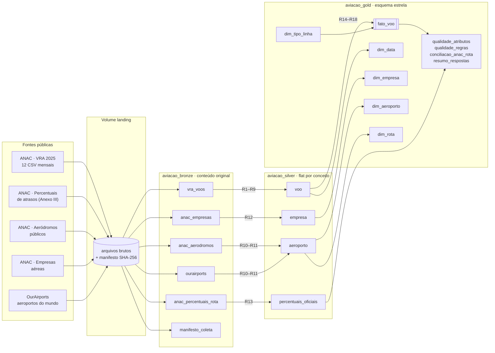
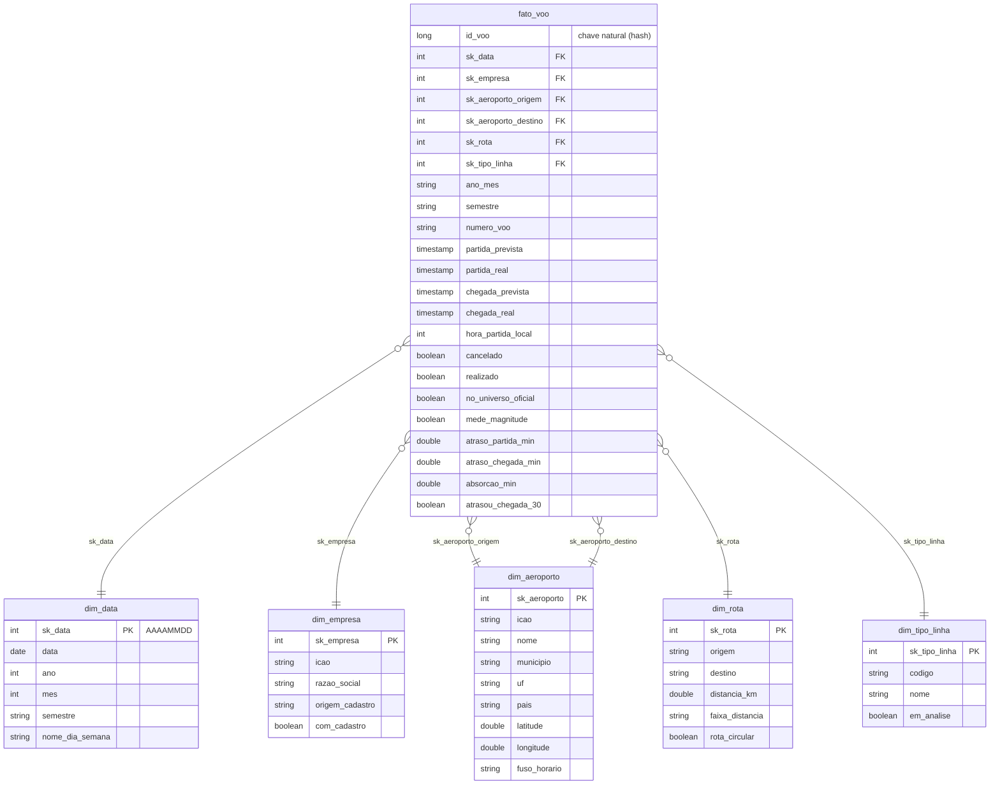

# Modelo de dados

## Arquitetura em camadas (medalhão) e linhagem

| Camada | Modelo | Carga | Propósito |
|---|---|---|---|
| landing | arquivos, como publicados | download (robô de coleta) | reprodutibilidade: bytes originais + hash |
| bronze | *flat* por fonte, conteúdo original (tudo em texto) | leitura dos arquivos + colunas de linhagem | reprocessar sem baixar de novo |
| silver | *flat* por conceito (Data Lake), tipado e sem duplicatas | regras R1–R13 | base limpa e reutilizável |
| gold | **esquema estrela** (Data Warehouse) | regras R14–R18 | consultas analíticas das perguntas P1–P5 |

Todas as tabelas são sobrescritas a cada execução (carga completa e idempotente): o volume é
moderado (≈ 1 milhão de etapas de voo) e isso elimina problemas de carga incremental num MVP.

## Esquema estrela (camada gold)

### Decisões de modelagem

* **Grão da fato: uma etapa de voo** (uma decolagem e um pouso), o menor grão que o VRA oferece. Cancelamentos
  e atrasos são medidas desse grão; agregá-las por empresa, rota, hora ou mês é uma simples soma.
* **`dim_aeroporto` com dois papéis** (*role-playing dimension*): a mesma dimensão serve à origem e ao destino.
* **Sinalizadores em vez de exclusão.** Voos extras, circulares, com atraso extremo ou com tempo inválido
  permanecem na fato, marcados por colunas booleanas; `no_universo_oficial` e `mede_magnitude` definem **o que entra
  em cada tipo de análise**. A escolha de excluir fica explícita e reversível, e a conciliação com a ANAC usa o
  mesmo universo que a ANAC usa.
* **Nenhuma chave nula.** Empresa ou aeroporto sem cadastro ganham uma linha própria na dimensão ("Sem cadastro
  na ANAC (XXX)"), preservando o código ICAO original (regra R14). A integridade referencial é verificada
  automaticamente no notebook `04_gold` (zero chaves órfãs).
* **Horários em UTC, hora local derivada.** O VRA está em UTC; a fato guarda os horários originais e acrescenta
  `hora_partida_local`, calculada com o fuso do aeroporto de origem.
* **Esquema estrela, e não *snowflake*:** as dimensões são pequenas (a maior, `dim_aeroporto`, tem ≈ 420 linhas) e
  desnormalizá-las simplifica as consultas sem custo relevante de armazenamento.

O detalhamento de cada atributo (tipo, domínio, nulos e linhagem) está no
[Catálogo de Dados](catalogo_de_dados.md).
